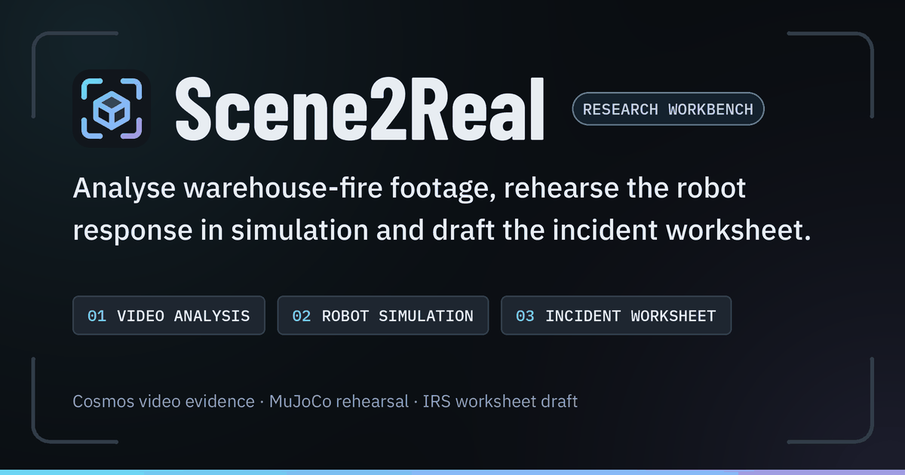
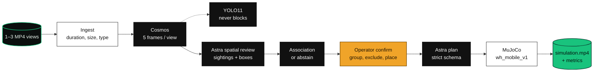
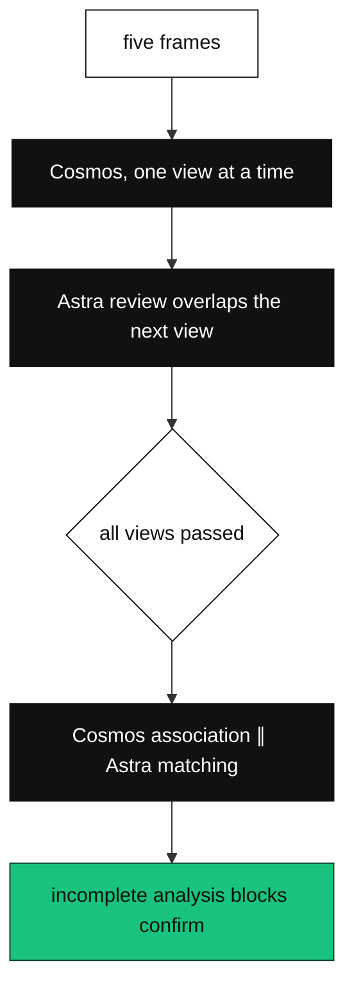
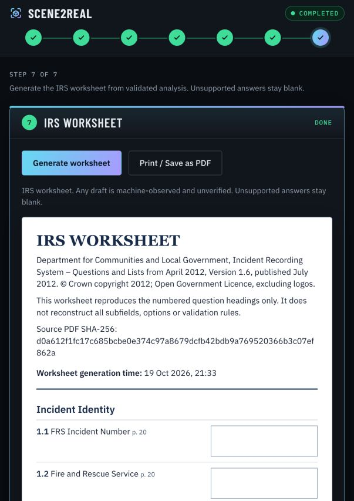
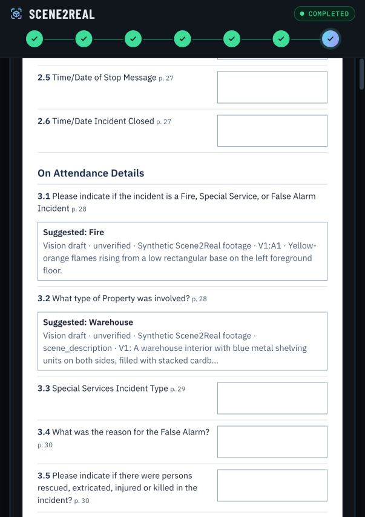

<p align="center">
  
</p>

<p align="center">
  
</p>

<p align="center">
  <strong>Warehouse-fire footage, one incident, a measured rehearsal.</strong><br>
  <sub>Videos → Cosmos evidence → operator-confirmed fires → Astra plan → MuJoCo rehearsal → recording and metrics.</sub>
</p>

<p align="center">VAST Builders Challenge (London, 17 Oct 2026), team 28.</p>

<p align="center">
  
  
  
  
  
  
  
</p>

---

## ▍The problem

A warehouse fire leaves camera footage and a robot that has not walked that aisle. The open question is which fires are the same object across views, and whether a scripted route would reach the ones an operator confirms.

Scene2Real is the workbench for one incident. The operator selects one to three views, reviews model evidence, confirms targets, and runs an authored MuJoCo rehearsal. The mobile flow is a demonstration. It is not a reconstruction of the incident and not a validated firefighting system.

The team corpus has no warehouse-fire footage. The demo uses labelled synthetic clips.

## ▍The pipeline



| Stage | Who decides | What is fixed |
| --- | --- | --- |
| **Ingest** | `ingest.py` | MP4 only, 1–120 seconds, ≤200 MB, one to three views of one incident |
| **Evidence** | `nvidia/cosmos3-nano-reasoner`, prompt `cosmos_fire_obs_v4` | Five timestamped frames per view. Raw response kept |
| **Supplement** | YOLO11 on CoreWeave | Extra detections. A YOLO failure does not stop analysis |
| **Spatial review** | `gpt-6-astra`, prompt `astra_fire_grounding_v1` | Effective sightings `A1`, `A2`, … with frame boxes. Cosmos observations stay for audit |
| **Association** | Astra plus a projective consistency check | Supported cross-view groups, or abstain and leave the sightings for the operator |
| **Confirm** | Operator | Every sighting is grouped or excluded with a reason. Zone and slot come from the authored template. Metric depth stays `null` |
| **Plan** | `gpt-6-astra` | A strictly validated instruction and plan. A provider failure is retryable. No silent substitute plan |
| **Rehearsal** | MuJoCo, `mobile.py` | Scripted six-DOF proxy on `wh_mobile_v1`. Success means every target gets ≥2.0 s of continuous valid spray exposure and zero unintended collisions |
| **Worksheet** | Browser only | 2012 IRS question headings. Not saved on the run. Not an official submission |

States are `uploaded → analysed → confirmed → scene_ready → completed`. `needs_review`, `blocked` and `failed` stop later stages. Server-side gates enforce that order. The [build contract](CONTRACT.md) is the API reference, including the retained legacy single-video path.

Cosmos calls stay serial and ordered. An Astra review of a finished view overlaps the next view. After every view passes, the two association checks run concurrently. Sampling, prompts and validation do not change. `timings_s.analyse` includes association; `analyse_views` and `analyse_association` split the phases. Older timers that excluded association are labelled "View processing".

Long analyse, scene and run calls use `POST /api/runs/{run_id}/operations` with `{"operation":"analyse"|"scene"|"run"}`. The response is HTTP 202. Poll `GET /api/runs/{run_id}/operations/{id}` for `pending`, `running`, `completed` or `failed`. One operation runs per run. The synchronous endpoints remain.



A run stores clips, `run.json`, scene XML, trajectory JSON and, after simulation, `simulation.mp4` under `runs/<run_id>/`. Optional VAST archival runs when `S3_ENDPOINT` and `S3_CHUNKS_BUCKET` are set. Weave tracing runs when `WANDB_API_KEY` is set. Absence of either is recorded in telemetry.

## ▍The demo

The workbench is `/`. Seven hash routes keep the run across refresh via the `run` query parameter.

| Hash | Page |
| --- | --- |
| `#video` | Choose up to three views of the same incident |
| `#analysis` | Cosmos evidence for the selected view |
| `#targets` | Group sightings, exclude the rest, pick zone and slot |
| `#instruction` | Astra instruction and warehouse scene |
| `#simulation` | Recorded trajectory, 1×/2×/4× playback, articulated G1 preview |
| `#metrics` | Per-target exposure, suppression, travel, contacts |
| `#report` | IRS worksheet draft |

`/training.html` opens in its own tab and leaves the workbench run open. It fits a two-parameter linear aim to synthetic 2D targets and compares it with a forward baseline on nine held-out positions. The browser G1 replays authored poses. Fire, spray, glance and walking are illustrative. There is no footage, no MuJoCo, no trained G1 controller and no saved result. If WebGL fails, the 2D diagram remains. Regenerate the compact mesh with `PYTHONPATH=. .venv/bin/python scripts/build_training_g1_asset.py`.

`/rehearsal.html` is a fixed-base G1 scene page: predefined arm poses, observer or robot camera, synthetic fire scenarios. It does not call a model and it does not authorise automatic spray. Menagerie G1 assets and the local Three.js files are copied dependencies. Licences stay in `assets/unitree_g1/` and `static/vendor/`.

Seven pinned clips ship in `clips/` (960,587 bytes). Six are CCTV-style fixtures: two incidents, three elevated views each, from `gpt-image-2` stills that were animated and compressed locally. They are not native generated video and not real CCTV. Independent edits changed the scene between views, so the fixtures do not establish physical-fire identity or camera calibration. Provenance is in [clips/demo_cctv_provenance.json](clips/demo_cctv_provenance.json). The seventh clip is `synthetic-warehouse-fire.mp4`.

On each load, a full-screen gate stays up until the clip catalogue, warehouse zones and all seven clips are verified as MP4 bytes, and for at least three seconds (`MIN_VISIBLE_MS`). A 45-second watchdog offers Retry. Verified bytes sit in the Cache API as `scene2real-demo-clips-v1`, keyed by `media_sha256`. Uploaded footage always streams from the run.

No committed screenshot shows the video, analysis or MuJoCo recording pages. The stills below are the worksheet QA captures.

<table>
  <tr>
    <td width="50%" valign="top">
      
      <br><b>07 · WORKSHEET HEADER.</b> QA still of <code>#report</code>. Nine sections, 158 numbered headings from the July 2012 IRS v1.6 index. Not current FaRDaP and not a validated submission.
    </td>
    <td width="50%" valign="top">
      
      <br><b>SUGGESTED DRAFTS.</b> That capture shows two unverified vision drafts and blank unsupported answers. Current <code>incident_report.js</code> fills each heading with a suggested value or a sample value. Edits stay in the browser and are not written to the run.
    </td>
  </tr>
</table>

Earlier stills in the same folder (`desktop.png`, `mobile.png`, `evidence-annex.png`, `print/contact-sheet.png`) are the prior worksheet delivery, including a separate evidence annex and a 13-page print. The [QA note](.prd-to-production/qa/historical-worksheet/results.md) says they are not the current form. The current page has no video evidence section. Print / Save as PDF rechecks the stored run before the print dialog. Reset, reanalysis, reconfirmation, run changes and evidence changes clear the in-browser snapshot.

The protected preview is [scene2real-workbench-trial-git-main-emanate-projects.vercel.app](https://scene2real-workbench-trial-git-main-emanate-projects.vercel.app). Deployment Protection stays on. An unauthenticated API request redirects to Vercel sign-in.

### Recorded checks

These numbers are from the QA notes. They are not a general accuracy or latency claim.

| Check | Record | Source |
| --- | --- | --- |
| Uncached three-view analysis | 78.28 s → 44.16 s wall time on one controlled pair. Same sighting counts. Gain is overlap, not faster Cosmos | [cosmos-latency.md](.prd-to-production/qa/cosmos-latency.md) |
| Box agreement | 21 of 21 annotated fires at the 2.5 s frame, IoU ≥ 0.5, minimum 0.7318. Six synthetic frames, approximate annotations | [spatial-fix.md](.prd-to-production/qa/spatial-fix.md) |
| CCTV rehearsals | Both sets abstained on cross-camera identity. V1-only targets, V2/V3 excluded. Four deterministic runs each. A same-video projective control produced four automatic three-view groups | [spatial-fix.md](.prd-to-production/qa/spatial-fix.md) |
| Backend suite at the latency check | 179 passed | [cosmos-latency.md](.prd-to-production/qa/cosmos-latency.md) |

Reproduce the box comparison against a local server on port 8090:

```sh
.venv/bin/python scripts/check_spatial_accuracy.py \
  --run-ids RUN1 RUN2 \
  --out /tmp/spatial-report.json
```

The script fetches those two runs. It does not call a model. It refuses a result that asserts cross-view identity.

## ▍Run it

Requirements: Python 3.12, `ffmpeg` and `ffprobe` on `PATH` (or the `static-ffmpeg` fallback), Node for the frontend checks, a WebGL2 browser for the G1 views.

```sh
git clone https://github.com/bede-lau/Scene2Real && cd Scene2Real
uv venv -p 3.12 .venv
uv pip install -p .venv -r requirements.txt
.venv/bin/static_ffmpeg_paths
./run_local.sh
```

Open `http://127.0.0.1:8090`. `run_local.sh` binds uvicorn there and reads `${XDG_CONFIG_HOME:-$HOME/.config}/scene2real/team.config`, or `TEAM_CONFIG`. Keep that file mode `600`.

| URL | What |
| --- | --- |
| `http://127.0.0.1:8090/` | Workbench |
| `http://127.0.0.1:8090/training.html` | Browser aiming demo. No key, no footage, no saved result |
| `http://127.0.0.1:8090/rehearsal.html` | Fixed-base G1 scene controls. No model call |
| `http://127.0.0.1:8090/healthz` | Process health. A green check does not prove the model endpoints |

**Keys.** Selecting a pinned clip, opening Training, and opening Rehearsal do not need a model key. Analysis needs `GPU_BEARER_TOKEN` for Cosmos and YOLO. Spatial review, association and the mobile plan need `OPENAI_API_KEY`. `ASTRA_MODEL` defaults to `gpt-6-astra`. `SCENE2REAL_SPATIAL_REVIEW` defaults to `auto` (on when the key is set); `1` requires review; `0` keeps unreviewed Cosmos boxes. A failed review blocks analysis. It does not fall back silently.

Optional: `WANDB_API_KEY`, `WANDB_TEAM`, `WANDB_PROJECT` for Weave; `S3_ENDPOINT`, `S3_CHUNKS_BUCKET`, `ACCESS_KEY`, `SECRET_KEY` for the VAST archive. `COSMOS_URL` and `YOLO_URL` override the model hosts. `SCENE2REAL_LIVE_COSMOS` stays off unless you mean to enable it. `SCENE2REAL_USE_CACHE=1` enables the analysis cache. Secrets stay on the server. Do not commit them or send them to the browser.

Restart after a config change.

### Team VM

```sh
rsync -az --exclude .venv --exclude .git --exclude runs ./ bc-mattlo0546:~/Scene2Real/
ssh bc-mattlo0546 'cd ~/Scene2Real && uv venv -p 3.12 .venv && uv pip install -p .venv -r requirements.txt'
ssh bc-mattlo0546 'cd ~/Scene2Real && .venv/bin/static_ffmpeg_paths'
ssh -L 8090:127.0.0.1:8090 bc-mattlo0546 'cd ~/Scene2Real && bash -lc ./run_vm.sh'
```

`run_vm.sh` sources `/config/team-28.config` and listens on `127.0.0.1:8090`. Then open `http://localhost:8090`.

### Tests

```sh
.venv/bin/python -m pytest
node tests/frontend_evidence_check.cjs
node tests/frontend_operations_check.cjs
node tests/incident_report_check.cjs
node tests/incident_report_edit_check.cjs
node --test tests/test_startup_gate.mjs tests/test_boot_retry.mjs tests/test_training_demo.mjs
node --test tests/test_site_api_proxy.mjs tests/test_upload_tickets.mjs tests/test_vercel_frontend.mjs
```

`tests/test_demo_media.py` is part of pytest. It checks registered clip files, traversal, range requests and ETags. The Playwright spec is `tests/e2e/incident-report.spec.mjs` (`npx playwright test` from `tests/e2e`, which boots `tests/e2e/serve_fixtures.sh`). Install `@playwright/test` from `tests/e2e/package.json` first. Acceptance helpers: `scripts/acceptance.py`, `scripts/acceptance_multiview.py`.

### Container

`Dockerfile` is the Python worker. It installs `requirements-production.txt`, copies the seven clips, MuJoCo, FFmpeg and software OpenGL, and runs as UID `10001`. It listens on `PORT` (default `10000`). `SCENE2REAL_FFMPEG_THREADS` defaults to `1` inside the image (allowed range 1–64). Outside the container, leaving it unset keeps FFmpeg's own thread choice. That setting changes encoder resources only.

Mount a persistent volume at `/data`. Runs live in `/data/runs`, caches in `/data/cache`. Copy the previous `runs/` in before cutover. A restart restores saved runs. In-memory jobs and live sessions do not survive. Run one instance.

`Dockerfile.vercel` is the static workbench plus `ops/vercel_frontend.mjs`. Root `vercel.json` selects it. Railway keeps the root `Dockerfile`. Both follow `bede-lau/Scene2Real` branch `main`.

On Vercel set `PORT=8080`, `SCENE2REAL_BACKEND_URL` to the Railway HTTPS origin, and `SCENE2REAL_SITE_TOKEN` to the same private token as the backend (at least 32 characters). Model keys belong on Railway only. Set `SCENE2REAL_PUBLIC_ORIGIN` to the Railway HTTPS origin so uploads above 3 MiB can take a two-minute, single-use grant. The grant allows one multipart `POST /api/runs`, is bound to the requesting browser origin, and caps the body at three 200 MB files plus multipart overhead. Python still validates type, count and size. The browser never receives the service token.

On the Hobby plan, `main` deploys to the protected Preview environment. Production tracking is reserved for `codex/manual-production`, which does not auto-deploy. Do not promote the app onto an unprotected production domain. Hobby requires the commit author to match the account owner.

Railway Free is 500 MB RAM and a 500 MB volume. Fresh full-pipeline tests exceeded that, including a `GALLIUM_DRIVER=softpipe` trial. On 25 October, Hobby passed both warehouse sets with a 1 GB limit, one vCPU, one replica and a 5 GB volume. The $10 compute cap stayed on. Keep `GALLIUM_DRIVER=llvmpipe`, `LP_NUM_THREADS=1`, `OMP_NUM_THREADS=1`, `OPENBLAS_NUM_THREADS=1` and `MALLOC_ARENA_MAX=2`. A 6 MiB direct upload passed on that deployment. Vercel returned `FUNCTION_PAYLOAD_TOO_LARGE` for the same file through its gateway, which is why the grant path exists. This was a sequential single-incident test. Details: [backend hosting QA](.prd-to-production/qa/backend-hosting.md).

### Linux systemd

Install into `.venv`, create mode-`600` `~/.config/scene2real/site-proxy.env`, then run `./ops/install_linux_services.sh` as the app user with non-interactive sudo. It installs user-scoped units on loopback ports `18090` and `18091`, with runs outside the checkout. It refuses units owned by another deployment. Private overrides go in `~/.config/scene2real/backend.env`. Set `SCENE2REAL_TUNNEL_CONFIG` only for a dedicated named tunnel to the proxy port. It does not change an existing SSH tunnel.

### macOS launchd

On the Mac that hosts the public Site API, after the mode-`600` team config:

```sh
./ops/install_macos_backend_service.sh
./ops/install_macos_site_proxy_service.sh
./ops/install_macos_cloudflare_tunnel_service.sh
```

The backend installer copies a private runtime to `~/Library/Application Support/Scene2Real/` because launchd cannot read a Desktop checkout. Backend binds `127.0.0.1:8090`. The proxy binds `127.0.0.1:8091`, requires the bearer token, and forwards `/api/` plus allowlisted workbench assets. Other paths are rejected. Store the token in the Sites secret `SCENE2REAL_SITE_TOKEN` and in `~/.config/scene2real/site-proxy.env`. Do not commit that file.

The named tunnel is `scene2real-api`, hostname `scene2real-api.thecosmoslabs.com`, credentials under `~/.cloudflared/`. `~/.cloudflared/scene2real-api.yml` must route that hostname to `http://127.0.0.1:8091`. Re-run the backend installer after backend code changes, and the proxy installer after proxy or token changes. Do not run `./run_local.sh` on a port a LaunchAgent already owns. The Mac has to stay awake.

## ▍Repository map

```
Scene2Real/
├── scene2real/          FastAPI app, pipeline, Cosmos, Astra, MuJoCo
│   ├── app.py           HTTP routes
│   ├── pipeline.py      state machine and persistence
│   ├── ingest.py        clip validation and frame sampling
│   ├── cosmos.py        cosmos_fire_obs_v4
│   ├── yolo.py          supplementary detections
│   ├── grounding.py     Astra spatial review
│   ├── matching.py      cross-view association
│   ├── planner.py       Astra instruction and plan
│   ├── mobile.py        wh_mobile_v1 scene, scripted motion, metrics
│   ├── rendering.py     simulation MP4
│   └── records.py       run files, optional VAST archive
├── static/              workbench, training, rehearsal, IRS worksheet
├── clips/               seven synthetic MP4s and provenance JSON
├── assets/unitree_g1/   Menagerie G1 (BSD-3-Clause)
├── third_party/unitree_r1/   reference URDF, meshes not included
├── ops/                 site proxy, upload grants, service installers
├── scripts/             acceptance, spatial check, demo generation, G1 asset
├── tests/               pytest, Node checks, Playwright fixture server
├── docs/unitree-r1.md   what the R1 proxy is and is not
└── .prd-to-production/  QA records and PRD workflow artifacts
```

| Doc | |
| --- | --- |
| [CONTRACT.md](CONTRACT.md) | API, run object, gates, legacy single-video path |
| [docs/unitree-r1.md](docs/unitree-r1.md) | Published R1 dimensions versus the six-DOF proxy |
| [architecture.md](architecture.md) | Training page only. No incident-footage claim |
| [decisions.md](decisions.md) | G1 visual: authored poses, not a trained policy |
| [design.md](design.md) | Training view behaviour, including the 2D fallback |
| [.prd-to-production/qa/spatial-fix.md](.prd-to-production/qa/spatial-fix.md) | Live Cosmos, Astra, simulation, box check |
| [.prd-to-production/qa/cosmos-latency.md](.prd-to-production/qa/cosmos-latency.md) | Overlap change and the 78.28 s / 44.16 s pair |
| [.prd-to-production/qa/backend-hosting.md](.prd-to-production/qa/backend-hosting.md) | Container, Railway, restart |
| [.prd-to-production/qa/results.md](.prd-to-production/qa/results.md) | Earlier end-to-end notes |

### PRD-to-production skill

Bede's PRD-to-production skill is bundled here. [CLAUDE.md](CLAUDE.md) loads [SKILL.md](.claude/skills/prd-to-production/SKILL.md). A checkout does not approve a product.

```sh
python3 .claude/skills/prd-to-production/scripts/sources.py verify
python3 .claude/skills/prd-to-production/scripts/workflow.py init --root .
python3 .claude/skills/prd-to-production/scripts/workflow.py status --root .
```

Python 3.9 or newer, standard library only. Artifacts land in `.prd-to-production/`. The offline reference bundle has 30 pinned files from OpenDesign, Impeccable, ReUI, coss ui and CopilotKit, with their original licences: Apache-2.0, MIT and AGPL-3.0. Bundling them does not assign a licence to Scene2Real. This repository has no root `LICENSE`.

| Resource | |
| --- | --- |
| [SKILL.md](.claude/skills/prd-to-production/SKILL.md) | Workflow |
| [compact.md](.claude/skills/prd-to-production/references/compact.md) | PRD compaction |
| [design.md](.claude/skills/prd-to-production/references/design.md) | Mockups |
| [build-verify.md](.claude/skills/prd-to-production/references/build-verify.md) | Implementation checks |
| [sources.md](.claude/skills/prd-to-production/references/sources.md) | Upstream map |
| [sources.lock.json](.claude/skills/prd-to-production/sources.lock.json) | Pinned revisions and hashes |

## ▍What this is, and isn't

We'd rather be precise than impressive.

- The clips are synthetic. The six CCTV views were generated independently and then edited, so matching across them is not a camera-calibration result. The same-video projective control is a control, not a second warehouse.
- Image boxes are not template positions. Uncalibrated metric depth is `null`. Confirmed groups and slots are operator decisions.
- The rehearsal robot is an authored six-DOF proxy sized from the published Unitree R1. The reference URDF is in `third_party/unitree_r1/`. Its 42 meshes are not bundled. Walking is scripted. Spray success is an exposure proxy: aim, range and line of sight for ≥2.0 continuous seconds, and no unintended collision. It is not fire or fluid physics.
- The browser G1, in Training and in Rehearsal, interpolates authored or predefined poses. It is not a trained controller and it does not drive the MuJoCo run.
- The IRS page reproduces the 2012 v1.6 numbered headings (9 sections, 158 questions). It does not reconstruct subfields, options or validation rules. Sample and suggested values are a demonstration. Nothing on that page is submitted anywhere.
- Legacy single-target planning can use W&B inference or its labelled fallback. The mobile flow does not. It requires Astra.
- Recorded latencies and the 21-box check are one session on synthetic frames. Stage timings in `run.json` are the measurement. No real-time claim.
- Passing the test suite does not mean every physical fire was seen.

## ▍Credits

| | |
| --- | --- |
| Video evidence | NVIDIA Cosmos (`nvidia/cosmos3-nano-reasoner`) on CoreWeave, prompt `cosmos_fire_obs_v4` |
| Supplementary detections | YOLO11 on CoreWeave. Optional. Never blocks the pipeline |
| Review, association, plan | OpenAI `gpt-6-astra`. `gpt-image-2` generated the demo stills |
| Legacy planner fallback | Weights & Biases inference, or the labelled fallback. Weave tracing is optional |
| Archive | VAST Data S3, optional |
| Simulation | [MuJoCo](https://github.com/google-deepmind/mujoco) 3.16 |
| R1 reference | Unitree Robotics URDF, BSD-3-Clause, revision `5994d4faef0a9cadd3287f8de0199a67eeb2a259`. See [docs/unitree-r1.md](docs/unitree-r1.md) |
| G1 meshes | [MuJoCo Menagerie](https://github.com/google-deepmind/mujoco_menagerie) `unitree_g1` at `62ab00f2bc44f6f20c1c9b7a13f3fb1dd41a4e35`, BSD-3-Clause |
| Browser 3D | Three.js, MIT, in `static/vendor/` |
| Worksheet source | DCLG, *Incident Recording System – Questions and Lists from April 2012, Version 1.6* (July 2012). Crown copyright 2012. Open Government Licence, excluding logos. SHA-256 `d0a612f1fc17c685bcbe0e374c97a8679dcfb42bdb9a769520366b3c07ef862a` |
| Workbench hosting | Vercel preview and Railway, as configured in `vercel.json` and `Dockerfile` |
| PRD workflow | Bundled skill under `.claude/skills/prd-to-production/` |

<p align="center"><sub>VAST Builders Challenge (London, 17 Oct 2026), team 28.</sub></p>
